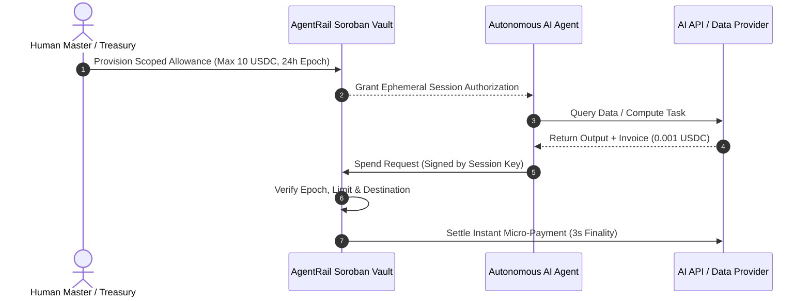

# AgentRail Protocol 🛰️🤖

[](https://github.com/SorobanAgents/agentrail/actions/workflows/ci.yml)
[](LICENSE)
[](DRIPS_WAVE.md)
[](https://stellar.expert/explorer/testnet/contract/CBSWWN2CLUPW4VLYTGVJTT4XWXKF6LLJFQXEC7KK2KTAW3A26WIBZIN6)
[](tsconfig.json)

**Autonomous AI Agent Scoped-Allowance & Micro-Settlement Protocol on Stellar & Soroban.**

AgentRail is the missing autonomous economic layer for AI agents. It gives autonomous LLM agents and multi-agent meshes the ability to stream sub-cent payments, pay for inference and data APIs, and contract work via Soroban smart contracts — **without exposing master private keys or requiring human popup clicks**.

---

## 🪐 Live Soroban Testnet Deployment

The AgentRail Core Smart Contract with native protocol fee monetization is compiled, optimized (20.7 KB wasm), and live on **Stellar Testnet**:

| Parameter | On-Chain Verification |
| :--- | :--- |
| **Network** | Stellar Testnet (`Test SDF Network ; September 2015`) |
| **Contract ID** | [`CBSWWN2CLUPW4VLYTGVJTT4XWXKF6LLJFQXEC7KK2KTAW3A26WIBZIN6`](https://stellar.expert/explorer/testnet/contract/CBSWWN2CLUPW4VLYTGVJTT4XWXKF6LLJFQXEC7KK2KTAW3A26WIBZIN6) |
| **Treasury Address** | [`GDDJH64X5VEXI7UWZMJA3YUG7ANYHKRRRFHLD2SF5OWEETNFBVYMRXZT`](https://stellar.expert/explorer/testnet/account/GDDJH64X5VEXI7UWZMJA3YUG7ANYHKRRRFHLD2SF5OWEETNFBVYMRXZT) |
| **Protocol Monetization Fee** | `20 bps` (0.20% per micro-spend transaction) |
| **WASM Hash (SHA-256)** | `cc753a83d462acbca4c5b95f95ec0eb82c445f8ea72f30ea7ef53cb07b0869dd` |
| **WASM Upload Tx** | [`59d7c99d1cbb5be6d5e14ef00257a4b34813ab1e854c5adc208c1c243ecb891b`](https://stellar.expert/explorer/testnet/tx/59d7c99d1cbb5be6d5e14ef00257a4b34813ab1e854c5adc208c1c243ecb891b) |
| **Contract Creation Tx** | [`53d84cc06853897e6feba01c4ea88927ae0857483140b44e5d2c58fee2a1db11`](https://stellar.expert/explorer/testnet/tx/53d84cc06853897e6feba01c4ea88927ae0857483140b44e5d2c58fee2a1db11) |
| **Initialization Tx** | [`88855f18c6e25268bd98fd9d32ee68d82d0c82381b9e3aa82c824f5857d01951`](https://stellar.expert/explorer/testnet/tx/88855f18c6e25268bd98fd9d32ee68d82d0c82381b9e3aa82c824f5857d01951) |
| **Deployer Address** | `GDQZK73NVQCDJTTUMOOLF7IZ55IY4GS2TF6SNE7P7DVJ7XWICYAGJJA5` |
| **Soroban SDK Version** | `27.0.2` (Target: `wasm32v1-none`) |

---

## 💰 Built-In Protocol Fee Monetization

AgentRail implements a sustainable on-chain protocol monetization engine:
- **Zero Friction Micro-Fee:** A standard fee of 20 basis points (0.20%) is calculated and routed automatically on every agent spend.
- **Treasury Payout Route:** Every micro-spend splits the payment on-chain: 99.80% settles to the service destination, while 0.20% routes directly to the designated protocol treasury wallet.
- **Configurable Governance:** Contract admin can adjust protocol fee parameters via `set_protocol_fee(treasury, fee_bps)` capped safely at 5.00% (500 bps).
- **Audit-Ready Events:** Dedicated Soroban topic events `("fee", "set")` and `("fee", "route")` provide real-time transaction transparency for on-chain indexing.

---

## ⚡ The Problem: Why Traditional Crypto Wallets Fail for AI

1. **Master Key Vulnerability:** Giving an autonomous agent full custody of a root private key (`S...`) means a single prompt injection or hallucination can drain the entire treasury.
2. **Human Popups Break Autonomy:** Standard browser extensions (Freighter, MetaMask) require manual 2FA clicks, completely breaking 24/7 background AI agents.
3. **Gas Fees Kill Micropayments:** Ethereum ($2–$10 gas) and Solana congestion make $0.0001 per-query inference payments economically impossible.
4. **Soroban State Archival (TTL Rent):** Soroban smart contracts and storage freeze if time-to-live (TTL) ledgers expire without active rent bumping.

---

## 🚀 The Solution: How AgentRail Works



---

## 🌟 Key Architecture & Capabilities

- **🔐 Cryptographic Scoped Allowances:** Time-bounded, maximum-spend capped allowances stored in Soroban smart contracts with designated routing rules.
- **⚡ Sub-Cent Real-Time Streaming:** Sub-second payment calculations for pay-as-you-prompt inference fees in native Circle USDC on Stellar.
- **🛡️ Proof-of-Task Escrow:** Decentralized SHA-256 output verification ensuring funds are only released when verifiable outputs are delivered.
- **🔄 Autonomous State TTL Keeper:** Continuous Soroban ledger monitoring and automated rent extension preventing state archival freeze.

---

## ⏱️ 5-Minute Quickstart

Clone the repository and run the test suite locally:

```bash
git clone https://github.com/SorobanAgents/agentrail.git
cd agentrail
npm install
npm test
npm run build
```

---

## 📦 SDK Usage Example

```typescript
import { AgentRailClient, usdcToStroops } from "@soroban-agents/agentrail";

const client = new AgentRailClient();

// 1. Provision a scoped allowance for an autonomous agent
client.registerAllowance({
  id: "agent-session-001",
  ownerPublicKey: "GOWNER...",
  agentPublicKey: "GAGENT...",
  maxStroops: usdcToStroops("10.00"), // 10 USDC ceiling
  spentStroops: 0n,
  validFrom: Math.floor(Date.now() / 1000),
  validUntil: Math.floor(Date.now() / 1000) + 86400, // 24 hours
  active: true,
});

// 2. Autonomous agent authorizes a micro-payment for API inference
const result = client.spend({
  allowanceId: "agent-session-001",
  agentPublicKey: "GAGENT...",
  destination: "GAPIPROVIDER...",
  amountStroops: usdcToStroops("0.0025"), // $0.0025 per query
  timestamp: Math.floor(Date.now() / 1000),
});

console.log("Spend Status:", result.code, "Remaining:", result.remainingStroops);
```

---

## 🌊 Stellar Drips Wave Program

AgentRail participates in the **Stellar Drips Wave Program**.

- **Application Checklist & Bounty Queue:** See [`DRIPS_WAVE.md`](DRIPS_WAVE.md) for initial scoped tasks.
- **Contributor Guidelines:** See [`CONTRIBUTING.md`](CONTRIBUTING.md).
- **On-Chain Claim:** Compliant [`FUNDING.json`](FUNDING.json) at repo root.

---

## 📄 License

Licensed under the [MIT License](LICENSE).
